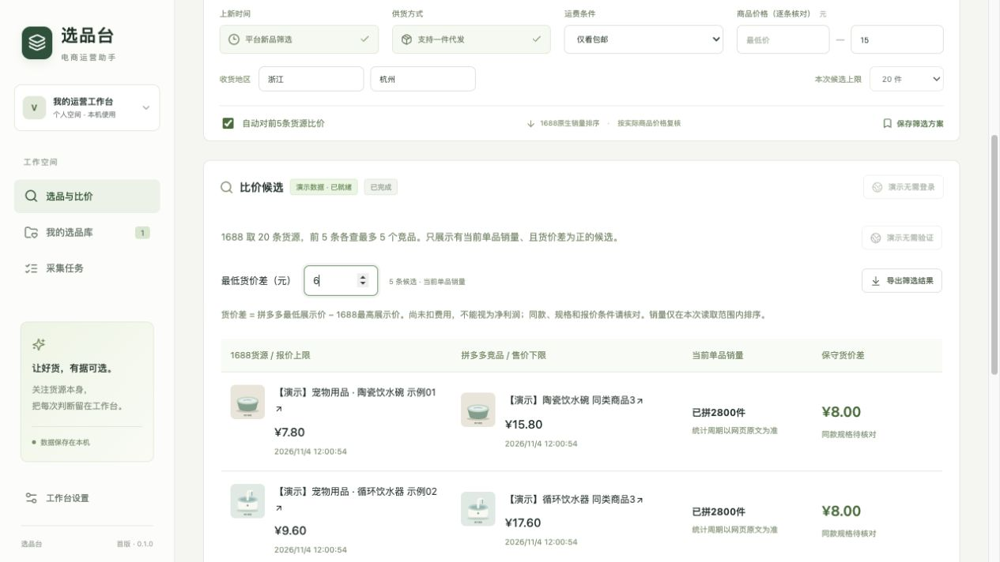
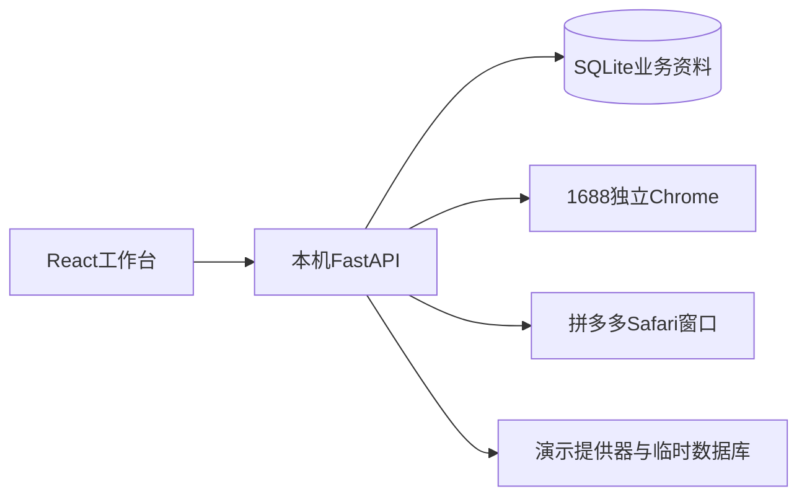

# 16882pdd · 选品台

面向一件代发业务的本地电商选品与竞品比价助手。

将1688货源筛选、拼多多关键词竞品查询、销量与售价整理、货价差对比和人工选品记录集中到一个工作台，减少在多个页面间反复查看和抄录数据的操作。

**v0.1.0 · 实验性MVP · 个人本机使用 · MIT许可**



> 截图来自演示模式。商品、供应商、价格、销量和时间全部为虚构示例，不代表真实平台结果。

## 已实现的流程

- **1688选品**：关键词、包邮条件、价格区间和收货地区；默认最多20个候选，复核整段规格报价，保留平台顺序及筛选依据。
- **拼多多竞品**：取合格货源前5件，按关键词查询；每件最多保留5条可比较竞品，展示单品销量、售价与链接。
- **结果优先**：优先展示有单品销量且保守货价差为正的候选，完整结果、排除原因和过程日志可展开复盘。
- **选品管理**：保存去重、标签、备注、状态、最多4件对比、中文CSV和本地业务数据备份。
- **任务管理**：串行限速、暂停、取消、保留完成结果和候选级断点；出现登录或访问限制时停止请求，由用户处理后继续。

保守货价差 = **拼多多最低展示价 − 1688最高展示价**。它尚未扣除运费、平台费用、推广和售后成本，同款及规格仍需人工核对。

## 先体验演示

演示模式无需平台账号，不启动Chrome或Safari，所有图片来自本地SVG。支持重新筛选、查看价差、保存、备注和CSV导出；生成的新记录也只在演示数据库中。

当前启动脚本面向macOS。准备Python 3.13、Node.js 22.12或更新版本，以及pnpm后，在源码目录执行：

```sh
python3 -m venv .venv
source .venv/bin/activate
python -m pip install -r requirements.lock.txt
pnpm install --frozen-lockfile
pnpm run build
python scripts/start.py --demo
```

浏览器打开 [演示工作台](http://127.0.0.1:8766)。准备好依赖后，也可双击根目录的“启动演示.command”。安装依赖时需要网络，演示业务本身不访问平台。

演示每次新启动服务都使用新的临时数据库，不读取正式的`data/`目录，也不继承`WORKBENCH_DATA_DIR`。关闭启动窗口或按Control+C停止服务；需要保留的演示修改请先导出。演示商品链接不可跳转，CSV内的平台格式链接和ID也是虚构占位。

## 使用真实采集

```sh
python scripts/start.py
```

打开 [本机工作台](http://127.0.0.1:8765)，或双击“启动工作台.command”。正式模式与演示模式使用不同端口。

1688使用独立Chrome资料；拼多多当前默认沿用Safari登录会话，在本服务创建的独立窗口采集。首次使用需要手动登录，Safari需要用户授予Apple事件控制和网页JavaScript权限，程序不会自动修改这些权限。

**Safari窗口采集不是真正无头。** Chrome无头代码保留备用，但真实搜索曾提示系统繁忙，尚未通过可用性验收。登录是否持续有效、平台能否访问及页面字段覆盖不由本项目保证。

每位使用者都需登录自己的账号，源码包不附带作者会话。具体步骤和权限范围见 [登录与隐私](docs/登录与隐私.md)；完整操作见 [用户指南](docs/用户指南.md)，已验证范围见 [已知限制](docs/已知限制.md)。

## 实现方式

前端采用React、TypeScript和Vite；后端采用Python、FastAPI和SQLite。界面通过本机接口访问任务、商品与运营记录，平台浏览器接入封装在独立提供器中。



平台原始商品资料与个人备注、标签、状态分别存储。演示提供器复用相同的筛选、任务、排名与价差计算逻辑，示例资料不会注入真实采集提供器。

- [架构与文件结构](docs/架构说明.md)
- [开发、验证与源码打包](docs/开发指南.md)
- [版本记录](CHANGELOG.md)
- [依赖与第三方说明](THIRD_PARTY_NOTICES.md)
- [资料与项目参考](docs/开源参考.md)

## 当前边界

这是可演示、可本机试用的第一阶段MVP。原生筛选模式保留未明确的上新天数和销量周期；不能将其宣传为逐件确认“15天上新”和“近30天销量”。拼多多销量只在本次读取、同单位且具有单品口径的范围内排序，关键词结果仍需人工判断是否同款。

真实浏览器辅助采集已有小批量记录；新版20→5→5整批的持续稳定性仍需更多真实验证。演示模式完成的链路不能替代真实平台验收。

图搜、销量增长判断、净利润测算、自动采购、商品上下架和多用户部署尚未实现。使用真实采集时，请遵守平台规则和账号权限；出现验证码或限制访问时由用户处理，不提供绕过能力。

## 许可

本项目采用 [MIT许可证](LICENSE)，版权署名为**16882pdd**。第三方依赖仍遵循各自许可证，平台商标和真实商品资料不因本项目开源而获得额外授权。项目与1688、拼多多平台无官方隶属关系。
